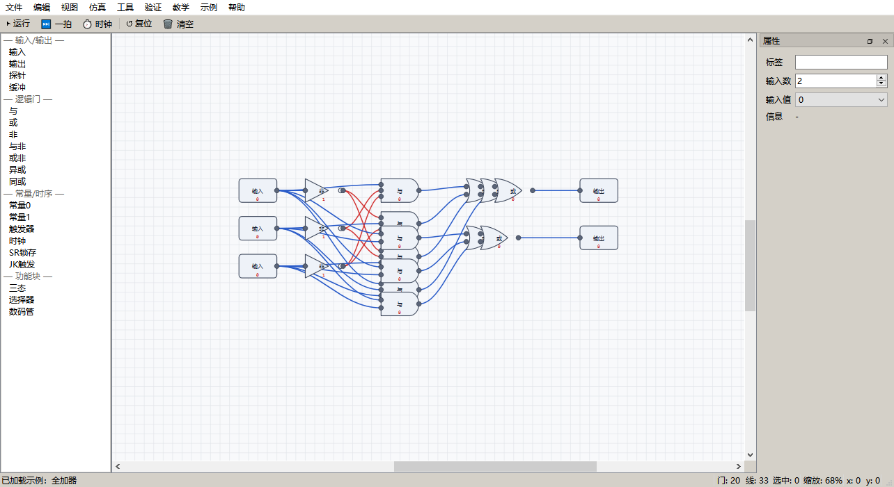
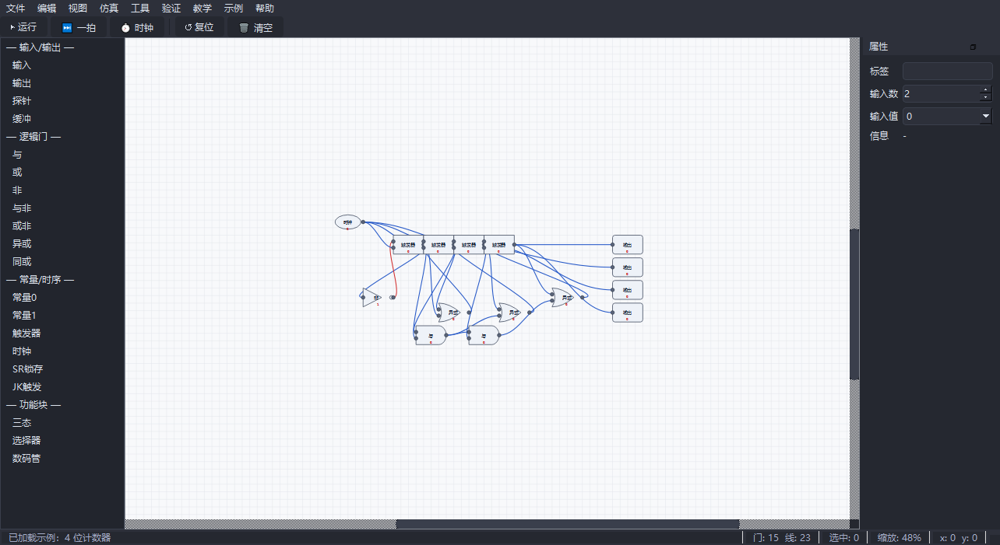
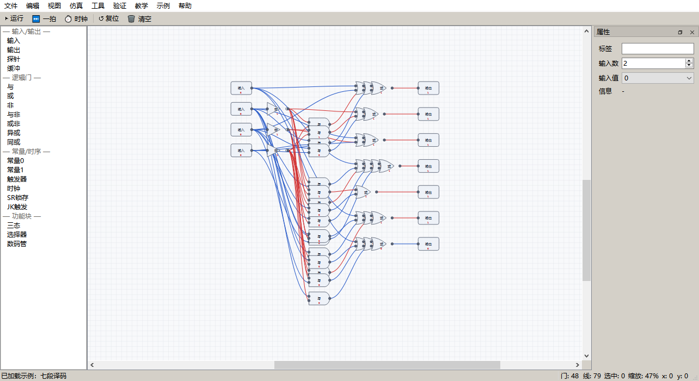
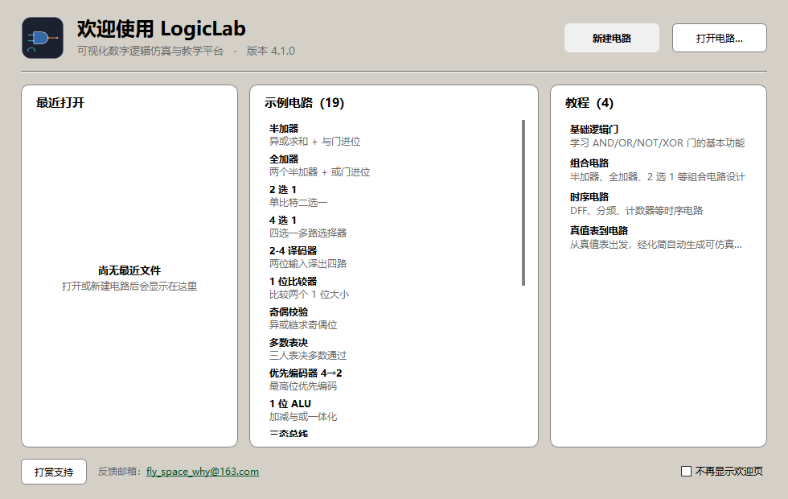
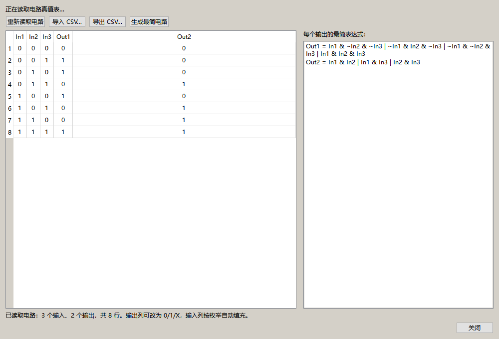
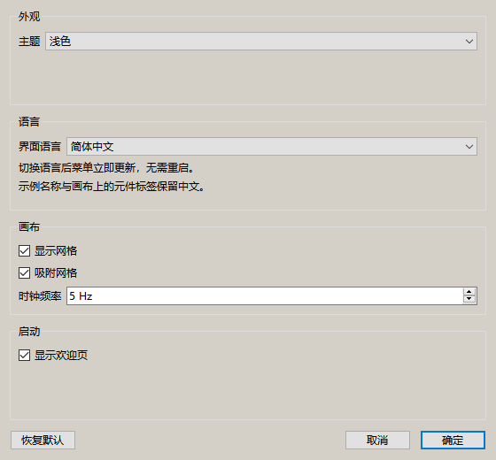

# LogicLab 4.1.0

**可视化数字逻辑仿真与教学平台** —— 拖拽搭电路，4 值逻辑（0/1/X/Z）实时仿真，真值表 ⇄ 电路双向，一键验证闭环，导出可综合 Verilog。



---

## 这是什么

LogicLab 是一个面向教学与自学的桌面逻辑电路工具：

- **拖拽即可搭电路**：左侧元件栏拖入画布，连线、改值、移动全程可撤销；
- **4 值逻辑内核**：0 / 1 / X（未知）/ Z（高阻）都是「一等公民」，三态总线、未接输入都按真实语义求值；
- **组合 + 时序**：与或非、异或同或、缓冲、常数、三态门、MUX、七段译码、DFF、SR、JK、时钟；
- **真值表 ⇄ 电路双向**：编辑真值表 → Quine–McCluskey 最简 SOP（含 XOR/XNOR 识别）→ 一键生成布局电路；也能从现有电路回读真值表与逻辑表达式；
- **结果可验证**：19 个自带参考输出的示例、一键示例自检、等价性检查、可综合 Verilog + 自检 testbench、VCD 波形、单位延迟时序报告。

核心仿真引擎为 C++ 动态库（C ABI），Python 侧经 `ctypes` 调用；界面只依赖 PySide6 + 标准库，**无其他第三方依赖**。

| 浅色（全加器） | 深色（4 位计数器） |
|---|---|
|  |  |

---

## 下载与安装

### 方式一：Windows 绿色免安装包（推荐）

1. 打开 Release 页面，下载 `LogicLab-4.1.0-win64.zip` 与同名 `.sha256`；
2. 校验压缩包（PowerShell）：
   ```powershell
   Get-FileHash .\LogicLab-4.1.0-win64.zip -Algorithm SHA256
   ```
   与 `.sha256` 文件中的值一致再进行下一步；
3. 解压到任意目录（例如 `D:\Tools\LogicLab`），**无需安装、无需管理员权限、不写注册表**；
4. 双击 `LogicLab.exe` 启动。首次启动会生成用户数据目录 `%APPDATA%\LogicLab`（设置 + 日志 + 自动恢复文件）。

### 方式二：从源码运行

```powershell
py -m pip install -r requirements.txt          # 仅 PySide6
$env:PATH = "C:\mingw64\bin;$env:PATH"       # Windows / MinGW-w64
python tools/build_core.py                     # 构建 build/logiclab_core.dll
$env:PYTHONPATH = "src"
python -m logiclab                              # 启动界面
python -m logiclab --version                    # 版本
python -m logiclab --selftest                   # 无界面自检（内核 + 19 示例）
```

Linux / macOS 的构建命令见 [docs/PLATFORMS.md](docs/PLATFORMS.md)。

### 卸载

- 绿色包：关闭程序后**直接删除解压出来的目录**即可；
- 如需彻底清理个人数据：删除 `%APPDATA%\LogicLab`（设置、日志、自动恢复、最近文件）；
- 源码方式：删除仓库目录与 `build/` 产物；`pip uninstall PySide6` 仅在你不需要 PySide6 时执行。

---

## 快速上手（1 分钟）

1. **启动**：双击 `LogicLab.exe`，在欢迎页点「打开示例」或直接进画布；
2. **放元件**：从左侧元件栏把「2 输入与门」「输入开关」拖进画布（或按 `Ctrl+V` 粘贴）；
3. **连线**：从输出引脚拖到输入引脚，连线颜色随电平变化（1 绿 / 0 灰 / X 黄 / Z 蓝）；
4. **仿真**：点「仿真 → 运行一次」或按 **F5**，输出门/探针立刻显示 0/1/X/Z；时序电路按 **F6** 走一拍、**F7** 开始/暂停时钟；
5. **验证**：点「帮助 → 示例自检」验证示例库，或「验证 → 导出 Verilog」拿到可综合网表。

> 想从规格出发？「工具 → 真值表 / 逻辑表达式...」编辑真值表后点「生成最简电路」。



---

## 界面概览

| 区域 | 内容 |
|---|---|
| 菜单栏 | 文件 / 编辑 / 视图 / 仿真 / 工具 / 验证 / 教学 / 示例 / 帮助 |
| 左侧元件栏 | 基础门、IO 元件（开关/探针/数码管）、时序元件、扩展模块 |
| 画布 | 拖拽放置、框选、滚轮缩放、网格吸附（`Ctrl+G` / `Ctrl+Shift+G`） |
| 右侧属性栏 | 选中元件/连线的属性编辑 |
| 状态栏 | 当前仿真状态、门数/连线数、内核版本 |
| 波形窗口 | 「工具 → 波形查看器」查看每个信号的历史电平 |



---

## 19 个示例

全部示例**自带参考输出**，可用「帮助 → 示例自检」或 `python -m logiclab --selftest` 一次验证，报告中显示「19 个示例全部通过」。菜单顺序与下表一致。

| # | 示例 | 覆盖知识点 |
|---|---|---|
| 1 | 半加器 | 异或 + 与、多输出电路 |
| 2 | 全加器 | 多输入进位的组合逻辑 |
| 3 | 2 选 1 | 基本 MUX 与选择端 |
| 4 | 4 选 1 | 多路选择、嵌套 MUX |
| 5 | 2-4 译码器 | 最小项生成、一热编码 |
| 6 | 1 位比较器 | 相等/大小判断 |
| 7 | 奇偶校验 | 异或级联 |
| 8 | 多数表决 | 三取二、卡诺图化简 |
| 9 | 优先编码器 4→2 | 优先级链、无关项处理 |
| 10 | 1 位 ALU | 运算选择、多路复用 |
| 11 | 三态总线 | 高阻 Z、总线冲突 |
| 12 | 七段译码 | 组合译码、数码管段码 |
| 13 | DFF 采样 | 时钟边沿、D 触发器 |
| 14 | T 触发器 2 分频 | 反馈、二分频 |
| 15 | 4 位计数器 | 时序级联、多拍仿真 |
| 16 | 4 位移位寄存器 | 串并转换、时钟驱动 |
| 17 | 1101 序列检测 | 状态机、寄存器反馈 |
| 18 | 交通灯 FSM | 状态编码与输出逻辑 |
| 19 | 4 位计数+七段显示 | 时序 + 组合联动（计数器驱动数码管） |

---

## 真值表 → 电路

「工具 → 真值表 / 逻辑表达式...」打开对话框：

1. 为每个输入/输出命名，逐行填 0/1/**X**（无关项）；
2. 实时显示最简表达式（最小 SOP，含 XOR/XNOR 识别，≤8 输入）；
3. 点「生成最简电路」直接把结果落成布局好的电路，可继续手工调线；
4. 反向也支持：从现有电路读入真值表、导出 CSV、从电路推导表达式。



---

## 一键验证闭环（规格 → 报证明）

「工具 → 一键验证闭环（规格→证明）...」：选择输出目录后，把当前电路（或给定真值表规格）交给无界面流水线 `logiclab.pipeline`：

真值表/网表 → 纯 ctypes 驱动 C++ 内核逐行仿真 → 与规格逐行比对 → 统计门数、连线数、关键路径 → 写出 **Markdown + 自包含 HTML 报告**。

- 不依赖 Qt，可在 CI、`--selftest` 中运行；
- 不一致时报告里给出反例行；失败不抛异常，返回带 `ok=False` 与错误列表的报告对象。

配套的可视化验证：
- 「验证 → 等价性检查...」：两个电路按真值表逐行比对，给出反例；
- 「仿真 → 波形」导出 VCD，可用 GTKWave 打开；
- 「工具 → 时序分析报告」：单位延迟估算（NOT 1 / AND·OR 2 / XOR 3 / MUX 2 / DFF 1）。


---

## 导出

| 导出项 | 位置 | 说明 |
|---|---|---|
| Verilog 网表 | 验证 → 导出 Verilog | 结构化网表（primitive / assign / always），确定性命名，DFF/JK 用 `always @(posedge clk)`，含自检 testbench 导出 |
| VCD 波形 | 工具 → 导出 VCD 波形 | 标准 VCD，变量名超过 26 个自动扩展 |
| 真值表 CSV | 真值表对话框 | 便于在 Excel/脚本中复用 |
| 验证报告 | 工具 → 一键验证闭环 | Markdown + 自包含 HTML |

---

## 快捷键

| 操作 | 快捷键 |
|---|---|
| 运行一次 / 走一拍 / 开始暂停时钟 | **F5 / F6 / F7** |
| 新建 / 打开 / 保存 / 另存为 | `Ctrl+N` / `Ctrl+O` / `Ctrl+S` / `Ctrl+Shift+S` |
| 撤销 / 重做 | `Ctrl+Z` / `Ctrl+Y` |
| 复制 / 粘贴 / 再制 / 全选 / 删除 | `Ctrl+C` / `Ctrl+V` / `Ctrl+D` / `Ctrl+A` / `Delete` |
| 放大 / 缩小 / 100% / 适应窗口 | `Ctrl+=` / `Ctrl+-` / `Ctrl+0` / `Ctrl+Shift+F` |
| 显示网格 / 吸附网格 | `Ctrl+G` / `Ctrl+Shift+G` |
| 快捷键说明 / 关于 | `F1` / 菜单「帮助 → 关于 LogicLab」 |

> 与程序内「帮助 → 快捷键」对话框中的表格**逐条一致**。

---

## 设置与语言

「视图 → 设置...（快捷键 `Ctrl+,`）」打开设置对话框，分四组：

| 分组 | 选项 | 说明 |
|---|---|---|
| 外观 | 主题：浅色 / 深色 | 立即生效并持久化 |
| 语言 | 简体中文 / English | **立即切换菜单、工具栏、状态栏与各对话框文案，无需重启** |
| 画布 | 显示网格、吸附网格、时钟频率 1–50 Hz | 立即应用 |
| 启动 | 显示欢迎页 | 关闭后直接进入编辑器 |

语言实现是轻量 i18n（`src/logiclab/i18n.py`，约 160 条英文词表，缺译回退中文）：
主菜单、工具栏、状态栏、帮助/关于/打赏/诊断/欢迎页/设置对话框均为英文，
**示例名称与画布内元件标签保留中文**（避免教学术语误译）。切换语言后窗口标题变为
`LogicLab 4.1.0 — Untitled`，设置项保存在 `%APPDATA%\LogicLab\settings.ini`。



---

## 性能（本机实测）

`python tools/bench.py` 在 Windows 11 x64、Python 3.13.5、内核 4.1.0 上的实测值（链式缓冲电路，每门一个信号）：

| 门数 | 编译 compile (ms) | 组合求值 evaluate (ms) | 单拍 tick (ms) | 快照·Python 循环 (ms) | 快照·C 批量 (ms) |
|---:|---:|---:|---:|---:|---:|
| 102 | 0.013 | 0.001 | 0.002 | 0.013 | 0.001 |
| 502 | 0.059 | 0.004 | 0.004 | 0.053 | 0.001 |
| 1002 | 0.113 | 0.007 | 0.007 | 0.104 | 0.001 |
| 2002 | 0.221 | 0.013 | 0.014 | 0.201 | 0.001 |
| 5002 | 0.566 | 0.058 | 0.057 | 0.496 | 0.002 |

结论：5000 门电路一次求值约 0.06 ms；读取全部信号用 `ll_snapshot` 批量拷贝比逐点 Python 调用快约 250 倍。复现：`set PYTHONPATH=src && python tools/bench.py`。

---

## 平台支持

| 平台 | 状态 | 说明 |
|---|---|---|
| **Windows 10/11 x64** | ✅ 实机验证 | 内核构建、pytest、`--selftest`、PyInstaller 打包、安装/卸载流程均实机验证 |
| Linux x64 | ⚠️ 仅 CI 构建与测试配置 | 本机**未实机运行**，未验证 GUI 渲染细节 |
| macOS | ⚠️ 仅 CI 构建与测试配置 | 本机**未实机运行**，未验证 GUI 渲染与签名 |

各平台依赖与命令：[docs/PLATFORMS.md](docs/PLATFORMS.md)。

---

## 已知限制

- 界面为**中文单语**；
- 时序仿真为**门级 / 单位延迟模型**，不是真实器件时序，不能替代 SPICE / 后仿真；
- 综合器面向教学化简：≤8 输入时给最简 SOP，超过则回退规范 SOP；不追求商业工具的面积/时序优化；
- 不覆盖模拟/混合信号电路，不提供 PCB 或芯片级流程；
- 未签名 PyInstaller 产物可能被杀毒软件误报，请核对 SHA256；
- Linux / macOS 未实机运行验证（见上表）。

---

## 参与开发与反馈

| 事项 | 入口 |
|---|---|
| 开发环境、构建内核、跑测试、提交规范、PR 检查单 | [CONTRIBUTING.md](CONTRIBUTING.md) |
| 安全漏洞上报（请勿开公开 issue） | [SECURITY.md](SECURITY.md) |
| 架构说明 | [docs/ARCHITECTURE.md](docs/ARCHITECTURE.md) |
| 平台支持 | [docs/PLATFORMS.md](docs/PLATFORMS.md) |
| 发布流程与产物校验 | [docs/RELEASE.md](docs/RELEASE.md) |
| 版本变更 | [CHANGELOG.md](CHANGELOG.md) |

测试与自检：

```powershell
$env:PYTHONPATH = "src"; $env:QT_QPA_PLATFORM = "offscreen"
python -m pytest                              # 内核 ABI / 版本 / Verilog / 打包 / 综合
python -m logiclab --selftest                 # 内核 + 19 示例
```

---

## 支持作者

如果 LogicLab 对你有帮助，欢迎打赏支持持续维护（金额随意，心意最重要）：


**作者邮箱：fly_space_why@163.com**（功能建议、bug 反馈、教学使用问题都欢迎）

---

## 许可证

[MIT License](LICENSE) © 2026 LogicLab Team
